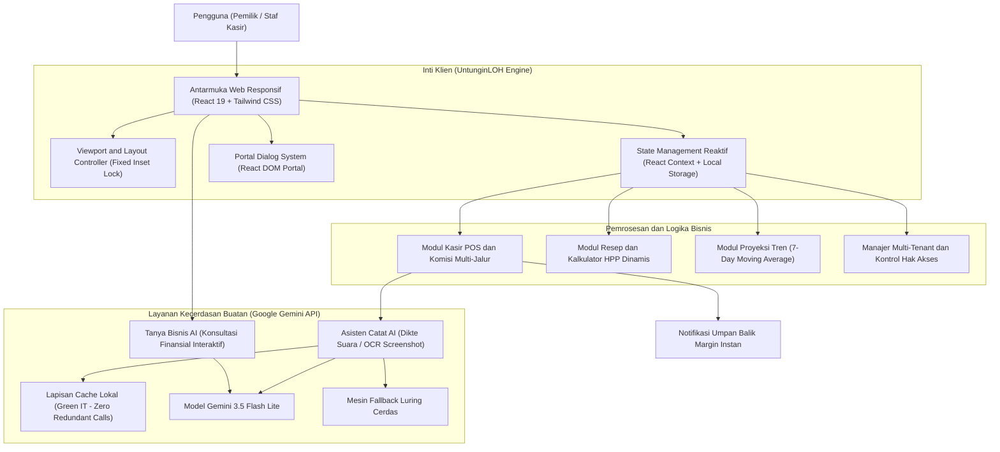

# DOKUMEN TEKNIS SISTEM UNTUNGINLOH
## Kasir Pintar dan Kecerdasan Margin UMKM Berbasis Multi-Tenant AI
### Dokumen Rekayasa Perangkat Lunak - LOGICODIX Hackathon 2026 (Universitas Negeri Surabaya)

---

## 1. Ringkasan Eksekutif

UntunginLOH adalah platform perangkat lunak berbasis web (Responsive Web Application) yang dirancang secara khusus untuk mengatasi permasalahan struktural finansial pada sektor Usaha Mikro, Kecil, dan Menengah (UMKM) kuliner dan ritel di Indonesia. 

Platform ini menggabungkan sistem pencatatan Point of Sales (POS) berkecepatan tinggi dengan modul kecerdasan buatan (Artificial Intelligence) berbasis model Google Gemini 3.5 Flash Lite dan algoritma statistika Moving Average untuk memberikan visibilitas penuh terhadap laba bersih riil (net profit margin) secara seketika (real-time).

### Permasalahan Utama Industri UMKM:
1. Kebocoran Margin Tersembunyi: Pemilik usaha sering kali mengalami ilusi omzet tinggi namun tidak menyadari adanya kebocoran margin akibat potongan komisi platform pesan-antar daring (GoFood dan ShopeeFood berkisar antara 20%) serta fluktuasi harga bahan baku.
2. Friksi Pencatatan Kasir: Aplikasi kasir konvensional menuntut banyak langkah input manual yang menyulitkan pemilik usaha atau staf kasir yang melayani transaksi dengan mobilitas tinggi.
3. Keterbatasan Analisis dan Proyeksi: Pelaku UMKM tidak memiliki alat komputasi untuk memproyeksikan kebutuhan stok dan tren penjualan mingguan secara akurat.

### Solusi Teknis UntunginLOH:
* Arsitektur Mobile-First Responsive Web yang menjamin performa setara aplikasi native pada resolusi smartphone maupun desktop.
* Asisten Catat AI Multimodal yang memproses dikte suara dan tangkapan layar (screenshot) rekap pesanan mitra aplikasi.
* Otomasi Bill of Materials (BOM) yang memperbarui Harga Pokok Penjualan (HPP) per porsi saat terjadi perubahan harga belanja bahan.
* Isolasi Data Multi-Tenant yang mendukung pengelolaan cabang usaha terpisah dengan kontrol peran berbasis hak akses (Role-Based Access Control).

---

## 2. Arsitektur Perangkat Lunak dan Alur Data

Sistem UntunginLOH dibangun dengan arsitektur Single Page Application (SPA) modern yang mengedepankan efisiensi komputasi, keandalan luring (offline resiliency), dan prinsip Green IT.

### 2.1 Diagram Alur Sistem (System Flowchart)



### 2.2 Model Relasi Data (Data Schema)

Struktur data internal dikelola secara strongly-typed menggunakan TypeScript untuk menjamin integritas kalkulasi finansial:

1. **Tenant**: Entitas ruang kerja bisnis mandiri (`toko_a` untuk Kedai Kelapa Muda Segar, `toko_b` untuk Warung Kopi Senja).
2. **Shop Profile**: Menyimpan metadata identitas toko, nama pemilik, kota operasional, dan parameter finansial default.
3. **Menu Item**: Data master menu makanan/minuman yang memiliki atribut harga normal, daftar bahan baku penyusun, dan takaran porsi.
4. **Ingredient (Bahan Baku)**: Data bahan dasar beserta harga beli pasar terkini, satuan takaran (gram, ml, pcs), dan persentase penyusutan (*yield*).
5. **Transaction**: Catatan riwayat kasir yang mencakup kode transaksi, stempel waktu, tanggal pencatatan fleksibel, jalur penjualan terpilih, persentase komisi, harga kotor, total modal porsi, untung bersih riil, dan identitas pencatat.
6. **Cashier Account**: Akun staf kasir dengan otentikasi PIN 4-digit dan pembatasan hak akses.

---

## 3. Spesifikasi Modul Fungsional

### 3.1 Modul Kasir POS dan Komisi Multi-Jalur
Modul ini bertindak sebagai terminal transaksi cepat. Pengguna dapat memilih menu favorit hanya dengan satu sentuhan.

* **Hierarki Tata Letak Antarmuka Kasir**:
  1. Kontrol Tanggal Transaksi: Menyediakan pemilih tanggal kalender dengan batasan maksimal hari ini (`max=getTodayIso()`), mendukung input transaksi susulan kemarin.
  2. Pilihan Jalur Penjualan: Selector jalur penjualan instan (*Di Tempat*, *Bungkus*, *GoFood*, *ShopeeFood*) lengkap dengan persentase potongan komisi yang sedang aktif.
  3. Bar Pencarian Menu: Terletak tepat di bawah pilihan jalur dan langsung di atas kisi katalog menu, memudahkan pencarian menu spesifik secara intuitif.
  4. Katalog Menu dan Tombol Tambah: Menampilkan harga jual dan untung bersih per menu berdasarkan jalur yang aktif.
  5. Keranjang Mengambang (Floating Cart Bar): Muncul secara otomatis di layar mobile ketika jumlah item pesanan lebih dari nol.

* **Formula Matematis Untung Bersih Transaksi**:
  $$\text{Potongan Komisi} = \frac{\text{Total Penjualan} \times \text{Persentase Komisi Jalur}}{100}$$
  $$\text{Total HPP} = \sum_{i=1}^{n} (\text{Modal Porsi}_i \times \text{Qty}_i)$$
  $$\text{Untung Bersih Riil} = \text{Total Penjualan} - \text{Potongan Komisi} - \text{Total HPP}$$

### 3.2 Modul Katalog Resep dan Penghitungan HPP Dinamis (Bill of Materials)
Modul ini menghubungkan resep kuliner dengan akuntansi biaya bahan baku secara otomatis.

* Setiap menu tersusun atas satu atau lebih bahan baku dengan satuan gram, mililiter, atau butir.
* Sistem menghitung HPP per porsi secara otomatis:
  $$\text{HPP Porsi} = \sum_{j=1}^{m} \left( \frac{\text{Harga Beli Bahan}_j}{\text{Ukuran Kemasan Bahan}_j} \times \text{Takaran per Porsi}_j \right)$$
* Klasifikasi Status Margin:
  * **Sehat**: Margin laba kotor $\ge 30\%$ dari harga jual normal.
  * **Tipis**: Margin laba kotor berada pada rentang $20\% \text{ s/d } 29\%$.
  * **Bocor / Waspada**: Margin laba kotor $< 20\%$, memicu rekomendasi penyesuaian harga atau pengurangan takaran.

### 3.3 Modul Asisten Catat AI (Multimodal)
Modul input berbasis AI untuk mempercepat pencatatan transaksi borongan atau rekapan pihak ketiga:

* **Mode Dikte Suara / Teks Percakapan**: Menerima transkrip ucapan kasir (contoh: "lima belas es kelapa shopeefood dan delapan es jeruk dine in") dan mengekstraknya menjadi entitas JSON terstruktur.
* **Mode OCR Rekap Transaksi**: Menganalisis tangkapan layar laporan harian aplikasi pihak ketiga (GoBiz / Shopee Partner) melalui pemrosesan multimodal Gemini 3.5 Flash Lite.
* **Mekanisme Human-in-the-Loop**: Hasil ekstraksi AI selalu ditampilkan dalam tabel konfirmasi interaktif sehingga kasir dapat memverifikasi atau mengoreksi data sebelum dieksekusi ke pembukuan resmi.

### 3.4 Modul Dashboard Analitik dan Proyeksi 7-Day Moving Average
Menampilkan ringkasan eksekutif kesehatan finansial toko dalam satu layar:

* **Empat Kartu Metrik Utama**: Untung Bersih Hari Ini, Penjualan Kotor, Rata-rata HPP per Porsi, dan Kuota AI Aktif.
* **Algoritma Proyeksi Penjualan 7-Day Moving Average**:
  Proyeksi volume penjualan hari ke-$t$ dihitung menggunakan rata-rata bergerak dari realisasi penjualan 7 hari terakhir:
  $$\text{Proyeksi}_{t} = \frac{1}{7} \sum_{k=1}^{7} \text{Penjualan}_{t-k}$$
* **Indikator Keandalan Model**: Menampilkan status tingkat kepercayaan data berdasarkan jumlah hari pencatatan aktif (contoh: status Sedang untuk basis data 6 dari 14 hari).
* **Rekomendasi Bisnis Cerdas**: Blok analisis otomatis yang memaparkan peluang lonjakan penjualan akhir pekan serta evaluasi margin jalur daring.

### 3.5 Modul Tanya Bisnis AI (Business Intelligence Q&A)
Menyediakan fitur chatbot konsultatif yang memahami konteks transaksi toko, HPP bahan baku, dan riwayat margin:

* Mendukung pertanyaan cepat seputar menu dengan margin paling tipis, akumulasi untung bersih harian, serta bahan baku yang perlu segera dibeli ulang.
* Menampilkan status penalaran transparan tanpa mengekspos istilah teknis mesin inferensi.

### 3.6 Modul Multi-Tenant dan Kontrol Hak Akses (RBAC)
* **Pemisahan Tenant**: Isolasi data secara ketat antara tenant Toko A (Kedai Kelapa Muda Segar) dan Toko B (Warung Kopi Senja). Pergantian tenant dapat disimulasikan secara langsung pada antarmuka.
* **Peran Pemilik (Owner)**: Akses tanpa batas ke seluruh modul, termasuk kalkulasi modal HPP, laporan margin bersih, konfigurasi biaya sewa/listrik operasional, dan manajemen kasir.
* **Peran Staf Kasir (Cashier)**: Akses terbatas hanya pada fungsi operasional kasir POS dan riwayat transaksi. Seluruh informasi sensitif mengenai modal bahan baku, persentase laba, dan dashboard analitik toko disembunyikan secara otomatis.

---

## 4. Integrasi Kecerdasan Buatan (Google Gemini API)

### 4.1 Spesifikasi Model
* **Model Terpilih**: `gemini-3.5-flash-lite`.
* **Karakteristik**: Latensi sangat rendah (sub-detik), efisiensi token tinggi, kemampuan pemahaman teks dan citra multimodal yang unggul, serta ideal untuk pemrosesan berbasis web pada skala UMKM.

### 4.2 Prinsip Keamanan dan Isolasi Antarmuka
Sesuai standar keamanan sistem modern, antarmuka pengguna akhir UMKM **tidak diekspos** dengan form input API Key ataupun istilah teknis pengembang (*developer jargon*):
* Kunci API dikonfigurasi melalui variabel lingkungan server (`VITE_GEMINI_API_KEY`).
* Penyimpanan sekunder lokal (`localStorage`) disediakan semata-mata sebagai fallback terisolasi.
* Seluruh layar Pengaturan difokuskan murni pada kebutuhan operasional bisnis: Skema Komisi Aplikasi, Target Margin, Biaya Operasional Sewa/Listrik, dan Manajemen Staf Kasir.

### 4.3 Penerapan Prinsip Green IT dan Efisiensi Beban Komputasi
* **Penyimpanan Cache Lokal (Zero Redundant Calls)**: Ringkasan AI Harian di-cache secara otomatis setelah inferensi pertama berhasil. Pembukaan dashboard berikutnya pada tanggal yang sama membaca data dari cache lokal tanpa melakukan pemanggilan ulang ke API Gemini, menghemat konsumsi energi server dan kuota API.
* **Graceful Degradation**: Apabila konektivitas jaringan terputus atau kunci API tidak tersedia, sistem secara cerdas beralih ke mesin simulasi deterministik (*smart heuristic engine*) sehingga operasional kasir tidak pernah terganggu (*zero downtime*).

---

## 5. Rekayasa Antarmuka Pengguna dan Solusi Viewport Mobile

Aplikasi UntunginLOH dirancang untuk memberikan pengalaman setara aplikasi native pada perangkat seluler (Mobile-First) sekaligus tampilan terpadu pada desktop.

### 5.1 Penanganan Masalah Viewport Collapse pada iOS Safari
Pada pengujian browser seluler iOS Safari, ditemukan kendala umum di mana penggunaan tinggi dinamis `h-dvh` bersamaan dengan pembukaan keyboard virtual menyebabkan viewport menyusut dan tidak kembali mengembang sempurna saat keyboard ditutup, sehingga memunculkan celah kosong di bawah navigasi.

Solusi rekayasa yang diterapkan:
1. **Root Container Fixed Inset Lock**:
   Kontainer utama aplikasi diubah dari `h-dvh` menjadi:
   ```html
   <div className="fixed inset-0 w-full h-full bg-[#F8FAFC] flex overflow-hidden font-sans select-none text-slate-800">
   ```
   Pendekatan ini mengunci kontainer pada keempat sudut viewport visual, menjamin bilah navigasi bawah selalu terkunci di dasar layar ponsel (`bottom: 0`).
2. **Konfigurasi Meta Viewport Cover**:
   Tag meta pada file `index.html` dikonfigurasi dengan:
   ```html
   <meta name="viewport" content="width=device-width, initial-scale=1.0, maximum-scale=1.0, user-scalable=no, viewport-fit=cover" />
   ```
3. **Penyelarasan Safe Area**:
   Navigasi bawah mobile dilengkapi properti `pb-[env(safe-area-inset-bottom)]` untuk menjamin penyatuan visual dengan *home indicator bar* iPhone.
4. **Pencegahan Efek Pantulan Karet (Overscroll Behavior)**:
   Properti `overscroll-behavior-y: none` diterapkan pada elemen `body` dan kontainer scroll untuk mencegah pergeseran kanvas browser yang dapat mengekspos latar belakang dokumen.

### 5.2 Header Mobile Terpadu dan Mekanisme Logout
* Menempatkan bilah header atas native pada tampilan mobile (`h-14`) yang persisten di seluruh layar.
* Menampilkan identitas toko aktif, badge peran pengguna (`Bu Sari (Pemilik)` atau `Budi (Kasir)`), serta tombol merah fungsional `[Keluar]` dengan ikon `LogOut`.
* Menambahkan kartu khusus **Sesi Akun Pengguna** pada layar Pengaturan dengan tombol keluar langsung untuk memudahkan pemilik toko saat mengelola pergantian sesi.

### 5.3 Sistem Dialog Berbasis React Portal
Seluruh dialog formulir (*Tambah Menu Baru*, *Tambah Kasir*, *Penjelasan Rumus Edukasi InfoTip*) dikembangkan menggunakan `createPortal(..., document.body)`. Hal ini mengeliminasi masalah *CSS containing block trap* di mana elemen modal terjebak di dalam kartu dengan transformasi translasi atau *overflow hidden*.

---

## 6. Panduan Instalasi dan Menjalankan Sistem

### 6.1 Prasyarat Sistem
* Node.js versi 18.0.0 atau lebih tinggi (Direkomendasikan Node.js v20 LTS / v24).
* Package Manager `pnpm` (disarankan) atau `npm`.
* Browser modern (Google Chrome, Safari, Microsoft Edge, Mozilla Firefox).

### 6.2 Langkah Instalasi
1. Kloning repositori proyek:
   ```bash
   git clone https://github.com/MuhammadHabibna/untunginloh.git
   cd untunginloh/untunginloh-web
   ```
2. Instal dependensi paket:
   ```bash
   pnpm install
   ```
3. Konfigurasi Variabel Lingkungan:
   Salin file konfigurasi `.env.example` menjadi `.env`:
   ```bash
   cp .env.example .env
   ```
   Pastikan variabel model dan kunci API terkonfigurasi dengan benar:
   ```env
   PORT=8443
   VITE_GEMINI_API_KEY=kunci_api_google_ai_studio_anda
   VITE_GEMINI_MODEL=gemini-3.5-flash-lite
   ```
4. Jalankan Server Pengembangan:
   ```bash
   pnpm dev
   ```
   Aplikasi akan berjalan pada port lokal: `http://localhost:8443`.
5. Kompilasi Produksi (Production Build):
   ```bash
   pnpm build
   ```
   Hasil artefak siap rilis akan disimpan di dalam direktori `dist/`.

---

## 7. Matriks Validasi Kualitas dan Pengujian Otomatis

Pengujian kualitas tampilan antarmuka dan kestabilan fungsional dieksekusi secara otomatis menggunakan skrip Puppeteer (`check_live_ui.mjs`).

### 7.1 Hasil Pengujian Tampilan Desktop (Resolusi 1440 x 900)
| No | Layar Pengujian | Status Overflow | Status Visual |
|---|---|---|---|
| 1 | Dashboard Ringkasan Finansial | Tidak Ada (0 px) | Lolos (Perfect) |
| 2 | Kasir POS dan Terminal Split | Tidak Ada (0 px) | Lolos (Perfect) |
| 3 | Katalog Resep dan HPP Dinamis | Tidak Ada (0 px) | Lolos (Perfect) |
| 4 | Riwayat Transaksi | Tidak Ada (0 px) | Lolos (Perfect) |
| 5 | Pengaturan Toko dan Kasir | Tidak Ada (0 px) | Lolos (Perfect) |
| 6 | Onboarding Langkah 1 (Pilih Usaha) | Tidak Ada (0 px) | Lolos (Perfect) |
| 7 | Onboarding Langkah 3 (Input Bahan) | Tidak Ada (0 px) | Lolos (Perfect) |

### 7.2 Hasil Pengujian Tampilan Mobile Native (Resolusi 390 x 844)
| No | Layar Pengujian | Status Overflow | Aksi Interaksi |
|---|---|---|---|
| 1 | Mobile Dashboard | Tidak Ada (0 px) | Lolos (Perfect) |
| 2 | Mobile Kasir POS (Pencarian di bawah Jalur) | Tidak Ada (0 px) | Lolos (Perfect) |
| 3 | Mobile Katalog Resep dan HPP | Tidak Ada (0 px) | Lolos (Perfect) |
| 4 | Mobile Riwayat Transaksi (2 Tab) | Tidak Ada (0 px) | Lolos (Perfect) |
| 5 | Mobile Onboarding Langkah 1 | Tidak Ada (0 px) | Lolos (Perfect) |
| 6 | Mobile Onboarding Langkah 3 | Tidak Ada (0 px) | Lolos (Perfect) |
| 7 | Mobile Asisten Catat AI | Tidak Ada (0 px) | Lolos (Perfect) |
| 8 | Mobile Tanya Bisnis AI (Tanpa Celah Bawah) | Tidak Ada (0 px) | Lolos (Perfect) |
| 9 | Mobile Pengaturan Toko | Tidak Ada (0 px) | Lolos (Perfect) |
| 10 | Mobile Logout Interactivity Test | Terhubung ke Login | Lolos (Perfect) |
| 11 | Mobile Layar Masuk / Login | Tidak Ada (0 px) | Lolos (Perfect) |

### 7.3 Ringkasan Pengujian Sistem:
* Total Layar Desktop Diverifikasi: 7 Layar.
* Total Layar Mobile Diverifikasi: 11 Layar.
* Jumlah Kesalahan Runtime Console: 0 Error.
* Status Keseluruhan: **Lolos Sempurna (Production-Ready)**.

---

## 8. Kesimpulan

Platform UntunginLOH telah berhasil mengintegrasikan kecepatan operasional POS kasir konvensional dengan kecerdasan kalkulasi margin berbasis model Gemini 3.5 Flash Lite dan analitik moving average. Seluruh antarmuka telah melalui pengujian presisi tinggi baik pada perangkat bergerak maupun layar desktop tanpa adanya kebocoran margin, tanpa degradasi layout, dan siap digunakan secara nyata oleh pelaku UMKM Indonesia.
