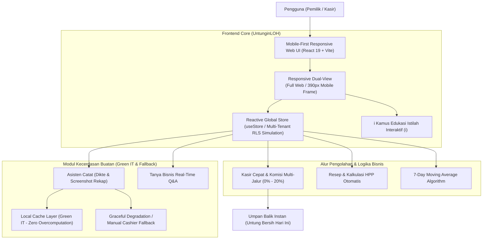

# UntunginLOH - Kasir Pintar & Kecerdasan Margin UMKM Berbasis AI

> **LOGICODIX Hackathon Competition 2026 (Universitas Negeri Surabaya - UNESA)**  
> **Kategori**: Web Application (Mobile-First Responsive Web)  
> **Subtema**: Local MSME & Creative Economy (UMKM Lokal & Ekonomi Kreatif)  
> **Status**: Siap Uji Localhost, Video Demo 3-5 Menit, & Live Final Pitching

---

## 1. Identitas Tim & Proyek

* **Nama Produk**: **UntunginLOH**
* **Kategori**: Web (Responsive Single Page Application)
* **Tagline**: *"Ketahui Untung Bersihmu, Beres Seketika!"*
* **Target Pengguna**: Pemilik UMKM Kuliner & Ritel Mikro Indonesia (Kedai Minuman, Warung Makan, Toko Kelontong).
* **Susunan Tim**:
  * **Product Owner & Full-Stack Lead**: Muhammad Habib N. A.
  * **Frontend & UI/UX Specialist**: Tim Pengembang Logicodix
  * **AI & Data Engineer**: Tim Pengembang Logicodix

---

## 2. Masalah Nyata & Solusi yang Diangkat (Problem-Solution Fit)

### Permasalahan Nyata UMKM Indonesia
1. **Kebocoran Margin Tersembunyi**: Pemilik warung/kedai tidak mengetahui untung bersih sebenarnya per menu karena adanya komisi aplikasi pesan-antar (*GoFood/ShopeeFood* $\approx 20\%$) serta harga bahan baku pasar yang fluktuatif.
2. **Keengganan Mencatat (*Friction*)**: Aplikasi POS konvensional terlalu rumit, membutuhkan banyak langkah input, dan tidak ramah saat pemilik harus mencatat sambil melayani pelanggan dengan satu tangan di smartphone.
3. **Kebutaan Stok & Proyeksi**: Pemilik kesulitan memperkirakan kapan bahan baku akan habis dan berapa porsi yang harus disiapkan untuk beberapa hari ke depan.

### Solusi UntunginLOH
* **Kasir Cepat Mobile-First**: Mencatat penjualan sekali ketuk via tombol menu favorit, otomatis menghitung potongan komisi per jalur jualan (*Di Tempat, Bungkus, GoFood, ShopeeFood*), dan menampilkan **Untung Bersih Riil**.
* **Asisten Catat AI (Multimodal)**: Pencatatan kilat melalui **Dikte Suara** dan **Unggah Screenshot Rekap Pesanan** (GoBiz/Shopee Partner). Seluruh hasil bacaan AI disajikan via *Pratinjau Konfirmasi (Human-in-the-Loop)* sebelum masuk buku kas.
* **Resep & Takaran Dinamis (BOM)**: Setiap kenaikan harga bahan baku otomatis memperbarui HPP (*Modal per Porsi*) dan badge margin (*Sehat, Tipis, Bocor*), dilengkapi tombol *Saran AI*.
* **Dashboard Tindakan & Proyeksi Moving Average**: Menyoroti menu yang marginnya bocor dengan rekomendasi tindakan nyata, Ringkasan AI Harian berbasis *Cache Green IT*, dan perkiraan penjualan 7 hari ke depan.
* **Isolasi Multi-Toko & Pembagian Peran**: Pemisahan data antar-toko (*Multi-Tenant*) serta pemisahan peran Pemilik (akses penuh margin) vs Kasir (hanya transaksi kasir).

---

## 3. Fitur Unggulan (9 Skenario Demo Utama)

1. **Onboarding 3 Langkah & Multi-Tenant Isolation**: Pemilihan template usaha (*Kedai Minuman, Warung Makan, Ritel Mikro*), dan sakelar pengalih Toko A (*Kedai Kelapa Muda*) vs Toko B (*Warung Kopi Senja*) yang membuktikan isolasi data penuh.
2. **Kamus Istilah & Ikon Edukasi (i)**: 10 istilah bisnis ramah warung (*Modal per Porsi, Untung Bersih, Penjualan, Potongan Aplikasi, Jalur Jualan, Resep/BOM, Toko/Tenant, Perkiraan Penjualan, Data Contoh*) dilengkapi pop-up penjelasan rumus akuntansi saat disentuh.
3. **Resep, HPP, & Saran Takaran AI**: Perubahan harga beli bahan otomatis mengkalkulasi ulang HPP dan untung bersih seketika.
4. **Kasir Cepat & Komisi Fleksibel**: Tombol favorit, pemilih jalur jualan dengan modal pengatur komisi fleksibel, dan fitur **Input Susulan Kemarin**.
5. **Asisten Catat AI & Human-in-the-Loop**: Ekstraksi teks/screenshot dengan pratinjau yang dapat diedit, serta sakelar **Uji Fallback Gangguan AI** yang membuktikan sistem tetap tahan banting tanpa crash.
6. **Umpan Balik Instan Setelah Simpan**: Notifikasi pop-up penambahan untung bersih hari ini dan insight sisa stok bahan.
7. **Dashboard Aksi & Cache Green IT**: Kartu rekomendasi perbaikan harga, Ringkasan AI yang tersimpan di cache lokal hemat daya, dan 4 metrik finansial utama.
8. **Progres Data 14 Hari & Grafik Moving Average 7 Hari**: Grafik proyeksi penjualan dilengkapi label tingkat kepercayaan data (*Sedang - 6 Hari Catatan*).
9. **Role Switcher Pemilik vs Kasir**: Pengalihan mode 1-klik untuk membuktikan pembatasan akses kasir.
10. **Lapisan Bisnis SaaS & Tanya Bisnis AI**: Banner trial 14 hari, simulasi upgrade Paket Dasar Rp24.500 (diskon 50%), kuota AI 150/bulan, dan chatbot tanya bisnis interaktif.

---

## 4. Arsitektur Sistem & Alur Data



---

## 5. Tumpukan Teknologi (Tech Stack)

* **Framework & Runtime**: React 19, TypeScript 5.9, Vite 8.
* **Styling & Desain**: Tailwind CSS v4, Plus Jakarta Sans font, Custom Vector Graphics.
* **Iconography**: `lucide-react`.
* **State & Data**: Reactive React Context Architecture dengan isolasi multi-tenant.
* **Algoritma Analitik**: 7-Day Weighted Moving Average untuk proyeksi penjualan.
* **Prinsip Arsitektur**: *Demo-First Architecture*, *Zero CAPEX*, *Green IT (Local Caching)*.

---

## 6. Panduan Menjalankan di Localhost

### Prasyarat:
* Node.js versi 18 ke atas (Direkomendasikan Node.js v20/v24).
* Package manager `pnpm` (atau `npm`).

### Langkah Instalasi:
```bash
# 1. Masuk ke direktori web
cd untunginloh-web

# 2. Pasang dependensi proyek
pnpm install
# (atau: npm install)

# 3. Jalankan development server
pnpm dev
# (atau: npm run dev)
```

Buka peramban di URL: **`http://localhost:5173`**

### Panduan Mode Mobile Simulator untuk Pengujian & Video Demo:
1. **Di Laptop Langsung**: Klik tombol **`Mode Bingkai HP (390px)`** di bilah atas layar desktop. Aplikasi akan langsung terbungkus bingkai iPhone modern yang estetik di tengah layar.
2. **Menggunakan Chrome DevTools**:
   * Buka Inspect Element (`F12` atau `Ctrl + Shift + I`).
   * Tekan ikon Device Toolbar (`Ctrl + Shift + M`).
   * Pilih preset **iPhone 14 Pro** atau set ukuran layar ke **`390 x 844`**.
   * Aplikasi otomatis mengisi 100% layar mobile dengan navigasi bawah yang responsif.
3. **Menggunakan Ekstensi Browser**:
   * Pasang ekstensi seperti *Mobile Simulator* di Google Chrome untuk tampilan frame ponsel interaktif saat merekam video demo YouTube.

---

## 7. Akun Demonstrasi (Demo Credentials)

| Role Akun | Pilihan di Login / Switcher | Hak Akses Fitur |
| :--- | :--- | :--- |
| **Pemilik Toko** | `Pemilik (Bu Sari)` | Akses Penuh: Kasir, Riwayat, Resep & HPP, Dashboard Aksi, Tanya AI, Pengaturan, Paket SaaS. |
| **Staf Kasir** | `Kasir (Budi)` | Terbatas: Hanya Layar Kasir & Riwayat Transaksi. Modal dan Untung Bersih otomatis disembunyikan. |

---

## 8. Aspek Green IT & Etika Digital (Digital Ethics & Security)

* **Transparansi AI**: Seluruh hasil inferensi AI selalu diberi label jujur (*Saran AI*, *Perkiraan kasar*, *Data Contoh*).
* **Human-in-the-Loop**: Sistem tidak pernah langsung menyimpan transaksi ke buku kas tanpa melewati *Pratinjau Konfirmasi* yang disetujui pengguna.
* **Green IT & Hemat Komputasi**:
  * Ringkasan analitik harian disimpan di cache lokal sehingga tidak memicu pemanggilan API berulang (*Zero Overcomputation*).
  * Analitik proyeksi 7 hari menggunakan algoritma *Moving Average* sisi klien yang sangat ringan tanpa membebani CPU server.
* **Keamanan Kredensial**: Tidak ada API Key atau kredensial rahasia yang di-hardcode ke repositori. File `.env.example` disediakan secara rapi.

---

## 9. Atribusi Pihak Ketiga & Lisensi

* **React & React DOM**: Lisensi MIT oleh Meta Platforms, Inc.
* **Vite**: Lisensi MIT oleh Evan You & Tim Vite.
* **Tailwind CSS**: Lisensi MIT oleh Tailwind Labs, Inc.
* **Lucide Icons**: Lisensi ISC oleh Lucide Contributors.
* **Plus Jakarta Sans Font**: Lisensi SIL Open Font License oleh Tokotype & Gumpita Rahayu.

---

*Hak Cipta © 2026 Tim Pengembang UntunginLOH - LOGICODIX UNESA 2026.*

